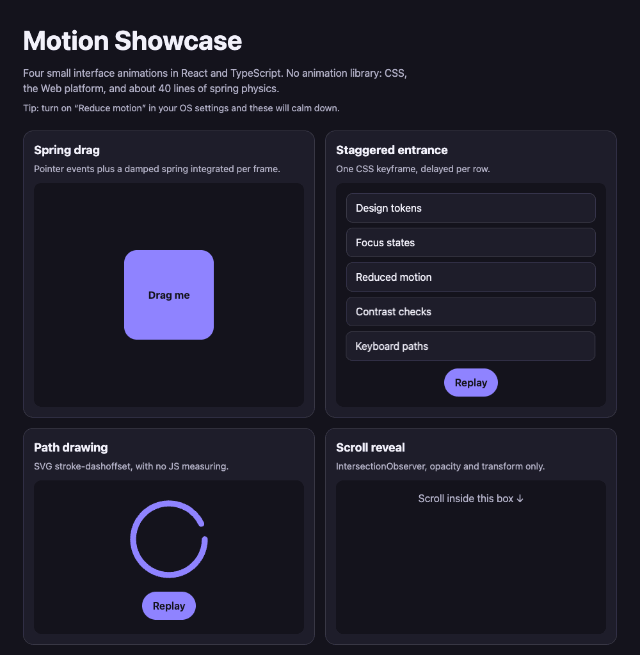

# Motion Showcase

[](https://github.com/rveruna/motion-showcase/actions/workflows/ci.yml)

**[Live demo](https://rveruna.github.io/motion-showcase/)**

[](https://rveruna.github.io/motion-showcase/)

Four small interface animations in React and TypeScript, built without an animation library.

| Demo | How it works |
| --- | --- |
| Spring drag | Pointer events, plus a damped spring (`src/hooks/spring.ts`) integrated every frame. Release velocity carries into the spring, so it overshoots. |
| Staggered entrance | One CSS keyframe with a per-row `animation-delay`. React only re-keys the list to replay it. |
| Path drawing | SVG `stroke-dashoffset` with `pathLength="1"`, so nothing is measured in JavaScript. |
| Scroll reveal | `IntersectionObserver` that disconnects after the first reveal. Only `opacity` and `transform` animate. |

## Decisions worth a look

- **Reduced motion is respected.** CSS turns the keyframes off, and the spring snaps back instead of bouncing when `prefers-reduced-motion` is set. The page reads the setting live with `useSyncExternalStore`.
- **Compositor-friendly properties only.** No animating `top`, `left`, `width` or `height`, so there is no layout work per frame.
- **Physics is a pure function.** `stepSpring` has no DOM in it and is unit-tested: it settles, it overshoots, and it stays stable after a dropped frame.
- **Accessible by default.** Visible focus rings, 44px touch targets, a keyboard-reachable scroll region, and a dark theme that follows the OS.

## Accessibility

`npm run a11y-audit` builds the page and runs [axe-core](https://github.com/dequelabs/axe-core) (WCAG 2.0 to 2.2, A and AA rules) in Chromium, in 8 states: light and dark, phone and desktop, reduced motion, after replaying the animations, and with the scroll-reveal cards revealed. It runs in CI and fails the build on any violation. Currently 0.

Animations are allowed to finish before each check. axe measures contrast on what is actually painted, so a half-faded element would fail for the wrong reason.

**The audit is itself tested.** I broke the page on purpose, one rule at a time:

| Deliberate break | Caught? |
| --- | --- |
| Low-contrast text in light mode | Yes, only in the light scenarios |
| Low-contrast text in dark mode | Yes, only in the dark scenarios |
| Scroll box not reachable by keyboard | Yes, `scrollable-region-focusable` |
| Animated SVG with no text alternative | Yes, `svg-img-alt` |
| Page with no `lang` | Yes, `html-has-lang` |
| Low contrast **only inside the scroll-reveal cards** | Yes, but only in the "cards revealed" and reduced-motion scenarios |

That last row is why those scenarios exist. Before they scroll into view the cards are invisible, and axe skips invisible content, so a plain page-load check would have missed it.

**Not tested:** a screen reader, 200% zoom, or Windows high-contrast mode. The drag demo is pointer-only (see "Not done"). Automated checks are a floor, not a guarantee.

## Run it

```bash
npm install
npm run dev      # http://localhost:5173
npm run build
npm test
npm run lint
npm run format
npm run a11y-audit   # builds, then runs axe in Chromium
```

## Not done

- The drag demo is pointer-only. A keyboard user can't move the card, and its label says so rather than pretending otherwise.
- No visual regression tests. Motion is checked by eye and by the unit tests on the maths.
